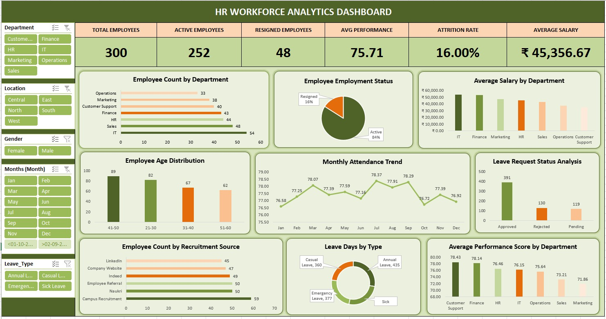
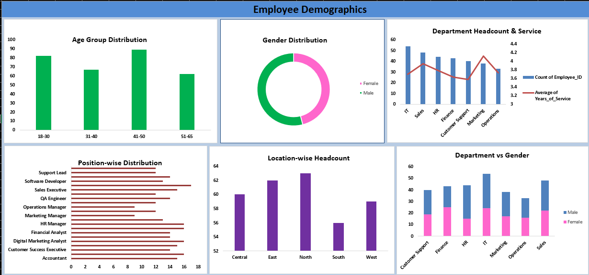
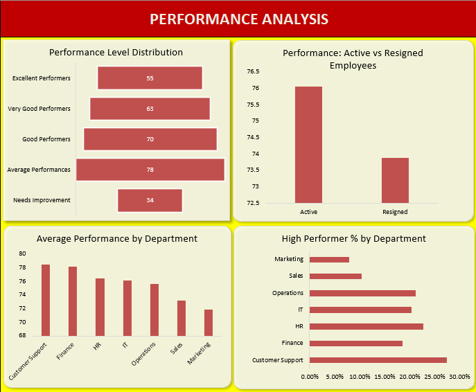
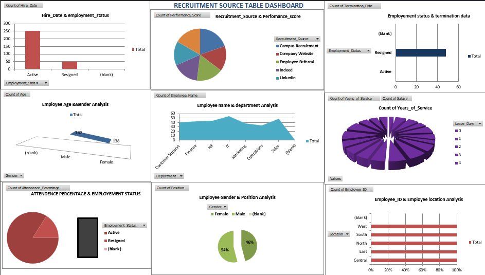
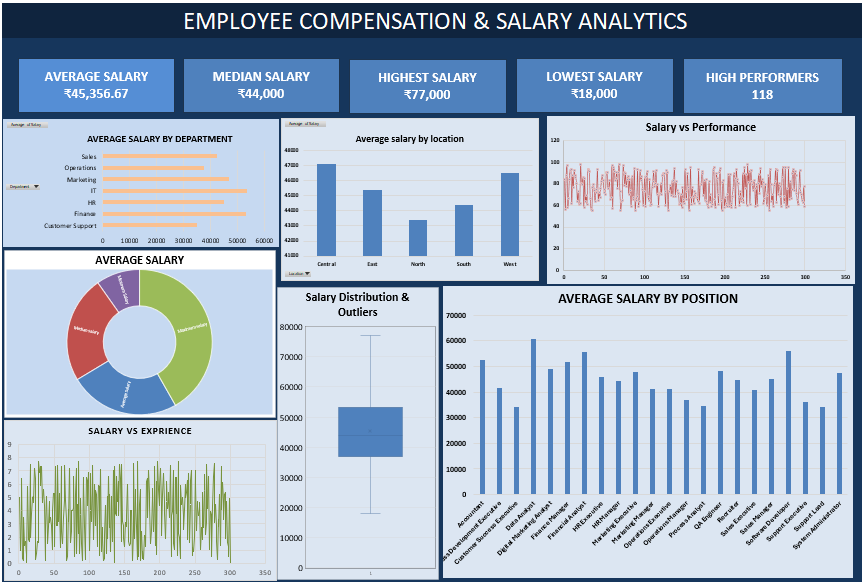

# 📊 HR Workforce Analytics

> An end-to-end HR Data Analytics project using **Excel, MySQL, Python, and Power BI** to analyze workforce data and generate meaningful HR insights through interactive dashboards.

---
## Dashboard Preview



---
## 🚀 Project Overview

**HR Workforce Analytics** is a data analytics project designed to transform raw HR data into meaningful business insights.

The project covers major HR areas such as:

- 👥 Employee Demographics
- 🧑‍💼 Recruitment Analytics
- 🕒 Attendance Analysis
- 🏖️ Leave Analytics
- 💰 Salary Analysis
- ⭐ Performance Analysis
- 📉 Attrition Analysis
- 🏢 Department-wise Analysis
- 📊 Interactive HR Dashboard

---

## 🎯 Project Objectives

The main objectives of this project are to:

1. Analyze employee demographics and workforce distribution.
2. Identify recruitment sources and their effectiveness.
3. Analyze employee attendance and absence patterns.
4. Understand leave utilization across departments.
5. Compare salary distributions across departments and positions.
6. Evaluate employee performance.
7. Identify patterns related to employee attrition.
8. Compare HR metrics across departments and locations.
9. Build an interactive Power BI dashboard for HR decision-making.
10. Demonstrate an end-to-end data analytics workflow.

---

## 📂Dataset

The accompanying Excel workbook contains these worksheets:

| Worksheet | Contents |
|---|---|
| `Employee_Master` | Employee details, department, position, salary, hire date, service, recruitment source, performance, attendance, leave, status, and location |
| `Attendance` | Monthly working days, present days, absent days, late days, and attendance percentage |
| `Leave` | Leave date, leave type, leave days, and request status |
| `Recruitment_Summary` | Recruitment source, total hires, average performance, and average salary |
| `README` | Dataset notes and recommended tools |

The workbook has **300 employee records** in `Employee_Master`, along with attendance, leave, and recruitment summary data.

---

> **Note:** All employee names and records in the dataset are synthetic/fictitious and intended only for academic and project demonstration purposes.

---

## 🛠️ Tools & Technologies

### - Microsoft Excel

### - MySQL

### - Python

- Libraries used:

```python
Pandas
NumPy
Matplotlib
Seaborn
```

### - Power BI

---

# 📊 HR Analytics Modules

## 1. 👥 Employee Demographics

Analysis of:

- Gender distribution
- Age distribution
- Age groups
- Department distribution
- Location distribution
- Employee count
- Position distribution
- Years of service

---

## 2. 🧑‍💼 Recruitment Analytics

Analyze how employees were recruited and compare recruitment channels.

### Key Analysis

- Total hires by recruitment source
- Average performance by source
- Average salary by source
- Recruitment source contribution
- Recruitment effectiveness

---

## 3. 🕒 Attendance Analytics

Analyze employee attendance and absence patterns.

### Key Metrics

- Average Attendance %
- Total Working Days
- Present Days
- Absent Days
- Late Days
- Department-wise Attendance
- Monthly Attendance Trends

This can help identify departments or periods with attendance issues.

---

## 4. 🏖️ Leave Analytics

Analyze employee leave patterns.

### Analysis Includes

- Total leave days
- Leave type distribution
- Approved vs rejected leaves
- Department-wise leave
- Monthly leave trends
- Employee-level leave analysis

### Leave Types

```text
Annual Leave
Sick Leave
Emergency Leave
```

---

## 5. 💰 Salary Analytics

Analyze compensation across the organization.

### Key Metrics

- Average salary
- Minimum salary
- Maximum salary
- Salary by department
- Salary by position
- Salary vs experience
- Salary distribution

---

## 6. ⭐ Performance Analytics

Analyze employee performance scores.

### Analysis Includes

- Average performance score
- Department-wise performance
- Performance by recruitment source
- Performance vs salary
- Performance vs attendance
- Top-performing departments

---

## 7. 📉 Attrition Analytics

Analyze employee turnover and identify potential patterns.

### Key Metrics

- Total Employees
- Active Employees
- Exited Employees
- Attrition Rate
- Attrition by Department
- Attrition by Gender
- Attrition by Age Group
- Attrition by Recruitment Source
- Attrition by Years of Service

### Attrition Rate

```text
Attrition Rate =
Number of Employees Who Left
----------------------------- × 100
Average Employee Count
```

---

## 8. 🏢 Department-wise Analysis

Compare departments using multiple HR metrics.

### Metrics

- Employee Count
- Average Salary
- Average Performance
- Average Attendance
- Leave Days
- Attrition
- Average Experience

This provides management with a department-level view of workforce health.

---


## 📊 HR Workforce Analytics Dashboard

The HR Workforce Analytics Dashboard provides an interactive overview of employee data, workforce distribution, attendance, leave, recruitment, and performance.

### Dashboard Components

- Total Employees
- Active Employees
- Resigned Employees
- Average Performance
- Attrition Rate
- Average Salary
- Employee Count by Department
- Employee Employment Status
- Average Salary by Department
- Employee Age Distribution
- Monthly Attendance Trend
- Leave Request Status Analysis
- Employee Count by Recruitment Source
- Leave Days by Type
- Average Performance Score by Department

### Interactive Filters

Users can filter the dashboard using the following slicers:

```text
Department
Location
Gender
Month
Leave Type
```

The dashboard helps HR teams analyze employee distribution, compare departmental salaries and performance, monitor monthly attendance trends, review leave requests, and understand recruitment patterns and employee attrition.


# 🗄️ MySQL Database

The HR dataset is converted into relational tables for SQL-based analysis.

### Main Tables

```text
Employee_Master
Attendance
Leave
Recruitment_Summary
```

---

# 🐍 Python Analysis

Python is used to perform additional data analysis and preprocessing.

```python
import pandas as pd

df = pd.read_excel("HR_Workforce_Analytics_Dataset.xlsx",
                   sheet_name="Employee_Master")

print(df.head())

print(df.info())

print(df.describe())
```

---

# 📊 Excel Analysis

Excel is used as the initial data preparation and exploration layer.

### Excel Techniques

- Sorting & Filtering
- Data Cleaning
- Conditional Formatting
- XLOOKUP
- SUMIF / SUMIFS
- COUNTIF / COUNTIFS
- AVERAGEIF / AVERAGEIFS
- Pivot Tables
- Pivot Charts
- Data Validation
- Age Group creation
- KPI calculations


---

# 🔄 End-to-End Project Workflow

```text
                ┌─────────────────┐
                │   HR Dataset    |
                └────────┬────────┘
                         ↓
                ┌─────────────────┐
                │      Excel      │
                │ Cleaning & EDA  │
                └────────┬────────┘
                         ↓
                ┌─────────────────┐
                │      MySQL      │
                │ SQL & Database  │
                └────────┬────────┘
                         ↓
                ┌─────────────────┐
                │     Python      |
                │ Pandas & EDA    │
                └────────┬────────┘
                         ↓
                ┌─────────────────┐
                │    Power BI     │
                │ Data Modeling   │
                │ DAX & Dashboard │
                └────────┬────────┘
                         ↓
                ┌─────────────────┐
                │ HR Insights &   │
                │ Decision Making │
                └─────────────────┘
```

---

# 💡 Business Questions

This project attempts to answer questions such as:

### Workforce

- How many employees are currently active?
- Which departments have the highest number of employees?
- What is the overall age distribution?
- Which locations have the largest workforce?

### Recruitment

- Which recruitment source generates the most hires?
- Which recruitment source has the highest-performing employees?
- How does salary vary by recruitment source?

### Attendance

- Which department has the highest attendance?
- Which employees have low attendance?
- How many absence and late days are recorded?

### Leave

- Which leave type is most frequently used?
- Which departments have the highest leave utilization?
- What percentage of leaves are approved?

### Salary

- Which department has the highest average salary?
- Which positions receive the highest salaries?
- Is salary related to years of service?

### Performance

- Which departments have the highest average performance?
- Is higher attendance associated with better performance?
- How does performance vary across recruitment sources?

### Attrition

- Which departments have the highest attrition?
- Which age groups experience higher employee turnover?
- Is attrition related to years of service?
- Which recruitment sources have higher employee exits?

---


## 📁 Repository Structure

```text
HR-Workforce-Analytics/
│
├── Dataset/
│   └── HR_Workforce_Analytics_Dataset.xlsx
│
├── Excel/
│   ├── Employee_Demographics_Analysis.xlsx
│   ├── Employee_Salary_Analysis.xlsx
│   ├── HR_Workforce_Analytics_Final.xlsx
│   ├── Performance_and_Department_Analysis.xlsx
│   └── Recruitment_Analysis.xlsx
│
├── Images/
│   ├── Employee_Demographics_Analysis_Dashboard.png
│   ├── Final_dashboard.png
│   ├── Performance_Analysis_Dashboard.png
│   ├── Recruitment_Analysis_Dashboard.png
│   └── Salary_Analysis_Dashboard.png
│
└── README.md
```

## 📊 Dashboard Preview

### Employee Demographics Dashboard



### Performance Analysis Dashboard



### Recruitment Analysis Dashboard



### Salary Analysis Dashboard



---

# 👥 Team & Responsibilities

This is a collaborative data analytics project where different team members can contribute to different stages of the pipeline.

| Member | Role | Module(s) |
|---|---|---|
|  **Priyanshi Gangwar** | Project Leader & Performance Analyst | Performance Analysis + Department-wise Dashboard |
|  **Tripti Gangwar** | Employee Data Analyst | Employee Demographics |
|  **Gayatri Singh** | Recruitment Analyst | Recruitment Analytics |
|  **Anju** | Compensation & Leave Analyst | Salary Analytics + Leave Analytics |
|  **Mohd. Aazam** | Attendance & Workforce Analyst | Attendance Analytics |
|  **Ashish Gangwar** | Workforce & Attrition Analyst | Attrition Analysis |

---

# 📌 Key Deliverables

The completed project aims to provide:

- ✅ Clean HR dataset
- ✅ Excel analysis
- ✅ MySQL database
- ✅ SQL analysis queries
- ✅ Python EDA
- ✅ Data visualizations
- ✅ Power BI data model
- ✅ Interactive HR dashboard
- ✅ HR business insights
- ✅ Project documentation

---

# 📚 Learning Outcomes

Through this project, the team demonstrates practical knowledge of:

```text
Data Cleaning
Data Analysis
Excel
Advanced Excel
SQL
MySQL
Python
Pandas
Exploratory Data Analysis
Data Visualization
Power BI
DAX
Data Modeling
Dashboard Design
Business Intelligence
Team Collaboration
```

---

# 🔮 Future Enhancements

Possible future improvements include:

- 🤖 AI-powered employee attrition prediction
- 📈 Employee performance prediction
- 🔍 Automated anomaly detection
- 📊 Advanced DAX analytics
- 🧠 Machine Learning-based HR insights
- 🔔 HR alert system
- 📱 Mobile-friendly dashboard
- ☁️ Cloud-based analytics pipeline
- 🔄 Automated data refresh

---

# ⚠️ Disclaimer

This project is created for **educational and portfolio purposes**.

The dataset contains **synthetic/fictitious HR records** and does not represent real employees or an actual organization's confidential HR data.

---

# ⭐ Project Goal

> **Turn HR data into actionable insights.**

The ultimate goal of this project is to demonstrate how multiple data analytics technologies can work together to transform raw workforce data into an interactive, decision-support system.

---

## 👨‍💻 Project

**HR Workforce Analytics**

**Technologies:**  
`Excel` • `MySQL` • `Python` • `Pandas` • `Power BI` • `DAX`

**Project Type:** Data Analytics / Business Intelligence

**Purpose:** Academic + Portfolio Project
