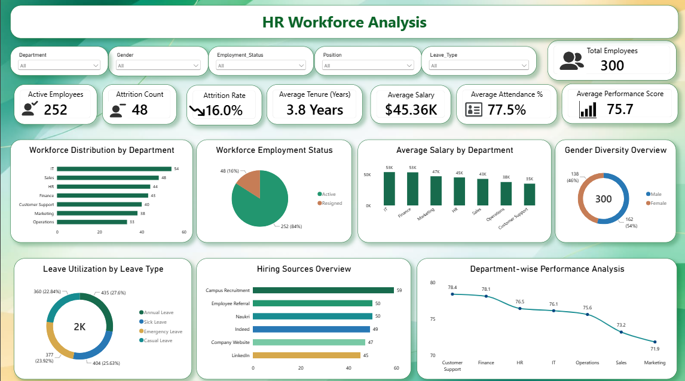
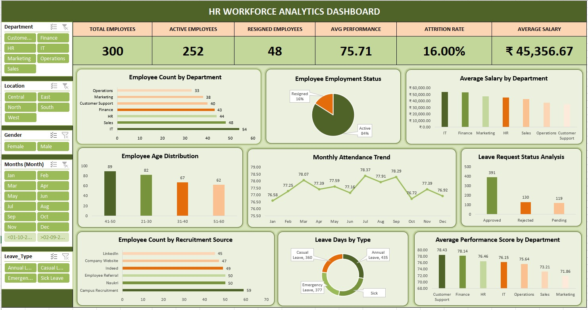
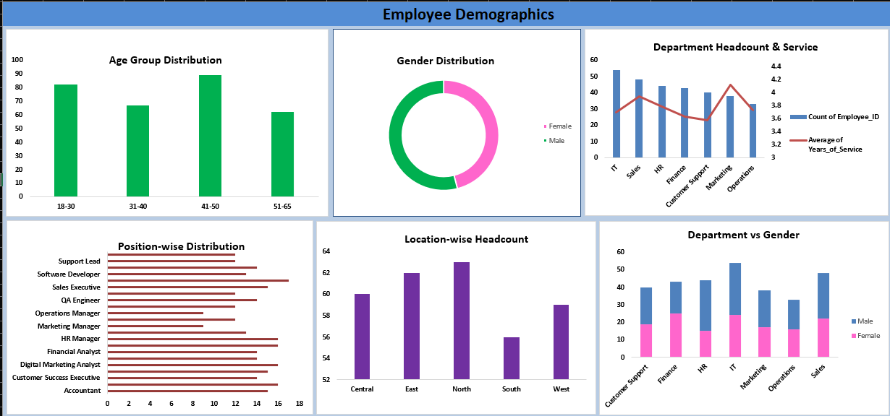
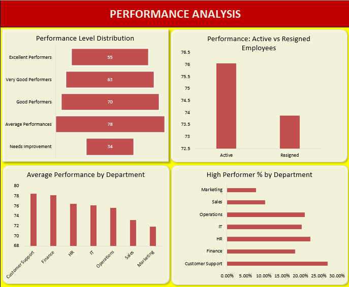
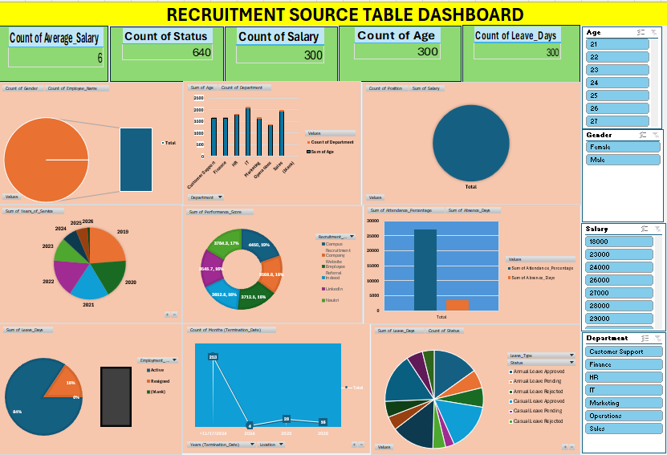
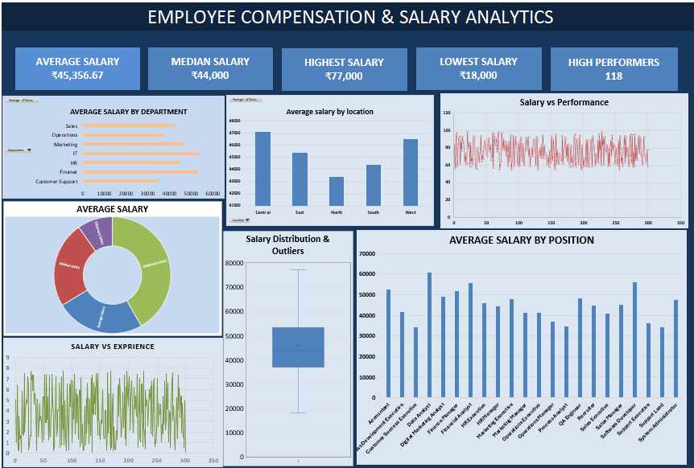

# 📊 HR Workforce Analytics

> An end-to-end HR Data Analytics project using **Excel, MySQL, Python, and Power BI** to analyze workforce data and generate meaningful HR insights through interactive dashboards.

---

## 📊 Final Dashboard Previews

### 1. Power BI Dashboard



### 2. Excel Dashboard



---

## 🚀 Project Overview

**HR Workforce Analytics** is a data analytics project designed to transform raw HR data into meaningful business insights.

The project covers major HR areas such as:

- 👥 Employee Demographics
- 🧑‍💼 Recruitment Analytics
- 🕒 Attendance Analysis
- 🏖️ Leave Analytics
- 💰 Salary Analysis
- ⭐ Performance Analysis
- 📉 Attrition Analysis
- 🏢 Department-wise Analysis
- 📊 Interactive HR Dashboards

---

## 🎯 Project Objectives

1. Analyze employee demographics and workforce distribution.
2. Identify recruitment sources and their effectiveness.
3. Analyze employee attendance and absence patterns.
4. Understand leave utilization across departments.
5. Compare salary distributions across departments and positions.
6. Evaluate employee performance.
7. Identify patterns related to employee attrition.
8. Compare HR metrics across departments and locations.
9. Build interactive dashboards using Excel and Power BI.
10. Demonstrate an end-to-end data analytics workflow.

---

## 📂 Dataset

The project uses an HR dataset containing employee information, attendance records, leave details, and recruitment summaries.

### Dataset Files

- `Attendance.csv`
- `Employee_Master.csv`
- `Leave.csv`
- `Recruitment_Summary.csv`
- `HR_Workforce_Analytics_Dataset.xlsx`

The dataset contains **300 employee records** in the Employee Master table.

> **Note:** All employee names and records are synthetic/fictitious and intended only for academic and project demonstration purposes.

---

## 🛠️ Tools & Technologies

### Microsoft Excel
- Data Cleaning
- Sorting & Filtering
- Conditional Formatting
- Advanced Excel Functions
- Pivot Tables
- Pivot Charts
- KPI Calculations
- Dashboard Creation

### MySQL
- Database Creation
- Data Import
- SQL Queries
- Data Filtering
- Aggregations
- Joins
- HR Data Analysis

### Python
- Pandas
- NumPy
- Matplotlib
- Seaborn
- Jupyter Notebook
- Exploratory Data Analysis (EDA)

### Power BI
- Data Transformation
- Data Modeling
- DAX Measures
- Interactive Visualizations
- KPI Cards
- Slicers
- Dashboard Design

---

# 📊 HR Analytics Modules

## 1. 👥 Employee Demographics

Analysis of:

- Gender Distribution
- Age Distribution
- Age Groups
- Department Distribution
- Location Distribution
- Employee Count
- Position Distribution
- Years of Service

## 2. 🧑‍💼 Recruitment Analytics

Analyze recruitment channels and hiring patterns.

### Key Analysis

- Total Hires by Recruitment Source
- Average Performance by Source
- Average Salary by Source
- Recruitment Source Contribution
- Recruitment Effectiveness

## 3. 🕒 Attendance Analytics

Analyze employee attendance and absence patterns.

### Key Metrics

- Average Attendance %
- Total Working Days
- Present Days
- Absent Days
- Late Days
- Department-wise Attendance
- Monthly Attendance Trends

## 4. 🏖️ Leave Analytics

Analyze employee leave patterns.

### Analysis Includes

- Total Leave Days
- Leave Type Distribution
- Approved vs Rejected Leaves
- Department-wise Leave
- Monthly Leave Trends
- Employee-level Leave Analysis

### Leave Types

- Annual Leave
- Sick Leave
- Emergency Leave

## 5. 💰 Salary Analytics

Analyze compensation across the organization.

### Key Metrics

- Average Salary
- Minimum Salary
- Maximum Salary
- Salary by Department
- Salary by Position
- Salary vs Experience
- Salary Distribution

## 6. ⭐ Performance Analytics

Analyze employee performance scores.

### Analysis Includes

- Average Performance Score
- Department-wise Performance
- Performance by Recruitment Source
- Performance vs Salary
- Performance vs Attendance
- Top-performing Departments

## 7. 📉 Attrition Analytics

Analyze employee turnover and identify potential patterns.

### Key Metrics

- Total Employees
- Active Employees
- Exited Employees
- Attrition Rate
- Attrition by Department
- Attrition by Gender
- Attrition by Age Group
- Attrition by Recruitment Source
- Attrition by Years of Service

## 8. 🏢 Department-wise Analysis

Compare departments using multiple HR metrics.

### Metrics

- Employee Count
- Average Salary
- Average Performance
- Average Attendance
- Leave Days
- Attrition
- Average Experience

---

# 📊 Dashboard Analysis

## 1. Excel HR Workforce Dashboard

The Excel dashboard provides an interactive overview of workforce data using KPI cards, charts, and slicers.

### Dashboard Components

- Total Employees
- Active Employees
- Resigned Employees
- Average Performance
- Attrition Rate
- Average Salary
- Employee Count by Department
- Employee Employment Status
- Average Salary by Department
- Employee Age Distribution
- Monthly Attendance Trend
- Leave Request Status Analysis
- Employee Count by Recruitment Source
- Leave Days by Type
- Average Performance Score by Department

### Interactive Filters

- Department
- Location
- Gender
- Month
- Leave Type

---

## 2. Power BI HR Workforce Dashboard

The Power BI dashboard provides an interactive view of workforce data through data modeling, DAX measures, and visual analytics.

---

## 📊 Additional Dashboard Visualizations

### Employee Demographics Dashboard



### Performance Analysis Dashboard



### Recruitment Analysis Dashboard



### Salary Analysis Dashboard



---

# 🗄️ MySQL Database

The HR dataset is converted into relational tables for SQL-based analysis.

### Main Tables

- Employee_Master
- Attendance
- Leave
- Recruitment_Summary

---

# 🐍 Python Analysis

Python is used to perform additional data analysis and preprocessing.

```python
import pandas as pd

df = pd.read_excel(
    "HR_Workforce_Analytics_Dataset.xlsx",
    sheet_name="Employee_Master"
)

print(df.head())
print(df.info())
print(df.describe())
```

---

# 🔄 End-to-End Project Workflow

```text
             HR Dataset
                 |
                 ↓
               Excel
          Cleaning & EDA
                 |
                 ↓
               MySQL
          SQL & Database
                 |
                 ↓
               Python
            Pandas & EDA
                 |
                 ↓
              Power BI
        Data Modeling & DAX
          Interactive Dashboard
                 |
                 ↓
        HR Insights & Decision Making
```

---

# 💡 Business Questions

### Workforce
- How many employees are currently active?
- Which departments have the highest number of employees?
- What is the overall age distribution?
- Which locations have the largest workforce?

### Recruitment
- Which recruitment source generates the most hires?
- Which recruitment source has the highest-performing employees?
- How does salary vary by recruitment source?

### Attendance
- Which department has the highest attendance?
- Which employees have low attendance?
- How many absence and late days are recorded?

### Leave
- Which leave type is most frequently used?
- Which departments have the highest leave utilization?
- What percentage of leaves are approved?

### Salary
- Which department has the highest average salary?
- Which positions receive the highest salaries?
- Is salary related to years of service?

### Performance
- Which departments have the highest average performance?
- Is higher attendance associated with better performance?
- How does performance vary across recruitment sources?

### Attrition
- Which departments have the highest attrition?
- Which age groups experience higher employee turnover?
- Is attrition related to years of service?
- Which recruitment sources have higher employee exits?

---

# 📁 Repository Structure

```text
HR-Workforce-Analytics/
│
├── Dataset/
│   ├── Attendance.csv
│   ├── Employee_Master.csv
│   ├── HR_Workforce_Analytics_Dataset.xlsx
│   ├── Leave.csv
│   └── Recruitment_Summary.csv
│
├── Excel/
│   ├── Employee_Demographics_Analysis.xlsx
│   ├── Employee_Salary_Analysis.xlsx
│   ├── HR_Workforce_Analytics_Final_.xlsx
│   ├── Performance_and_Department_wise_Analysis.xlsx
│   └── Recruitment_Analysis_.xlsx
│
├── Images/
│   ├── Employee_Demographics_Analysis_Dashboard.png
│   ├── Final_dashboard_excel.png
│   ├── Final_dashboard_powerBI.png
│   ├── Performance_Analysis_Dashboard.png
│   ├── Recruitment_Analysis_Dashboard.png
│   └── Salary_Analysis_Dashboard.png
│
├── PowerBI/
│   └── HR_WORKFORCE_ANALYTICS_FINAL.pbix
│
├── Project_Report/
│   ├── HR_Workforce_Analytics_FINAL_Report_File_-1.pdf
│   └── HR_Workforce_Analytics_FINAL_Report_File_.docx
│
├── Python_Analysis/
│   └── HR Workforce Analysis Project.ipynb
│
└── README.md
```

---

# 👥 Team & Responsibilities

| Member | Role | Module(s) |
|---|---|---|
| Priyanshi Gangwar | Project Leader & Performance Analyst | Performance Analysis + Department-wise Dashboard |
| Tripti Gangwar | Employee Data Analyst | Employee Demographics |
| Gayatri Singh | Recruitment Analyst | Recruitment Analytics |
| Anju | Compensation & Leave Analyst | Salary Analytics + Leave Analytics |
| Mohd. Aazam | Attendance & Workforce Analyst | Attendance Analytics |
| Ashish Gangwar | Workforce & Attrition Analyst | Attrition Analysis |

---

# 📌 Key Deliverables

- ✅ Clean HR Dataset
- ✅ Excel Analysis
- ✅ MySQL Database
- ✅ SQL Analysis Queries
- ✅ Python EDA
- ✅ Data Visualizations
- ✅ Power BI Data Model
- ✅ Interactive Excel Dashboard
- ✅ Interactive Power BI Dashboard
- ✅ HR Business Insights
- ✅ Project Documentation

---

# 📚 Learning Outcomes

Through this project, the team demonstrates practical knowledge of:

- Data Cleaning
- Data Analysis
- Advanced Excel
- SQL & MySQL
- Python & Pandas
- Exploratory Data Analysis
- Data Visualization
- Power BI & DAX
- Data Modeling
- Dashboard Design
- Business Intelligence
- Team Collaboration

---

# 🔮 Future Enhancements

- AI-powered Employee Attrition Prediction
- Employee Performance Prediction
- Automated Anomaly Detection
- Advanced DAX Analytics
- Machine Learning-based HR Insights
- HR Alert System
- Mobile-friendly Dashboard
- Cloud-based Analytics Pipeline
- Automated Data Refresh

---

# ⚠️ Disclaimer

This project is created for **educational and portfolio purposes**.

The dataset contains synthetic/fictitious HR records and does not represent real employees or an actual organization's confidential HR data.

---

# ⭐ Project Goal

> **Turn HR Data into Actionable Insights.**

The ultimate goal of this project is to demonstrate how multiple data analytics technologies can work together to transform raw workforce data into an interactive, decision-support system.

---

## 👨‍💻 Project Information

**Project:** HR Workforce Analytics

**Technologies:** `Excel` • `MySQL` • `Python` • `Pandas` • `Power BI` • `DAX`

**Project Type:** Data Analytics / Business Intelligence

**Purpose:** Academic + Portfolio Project
